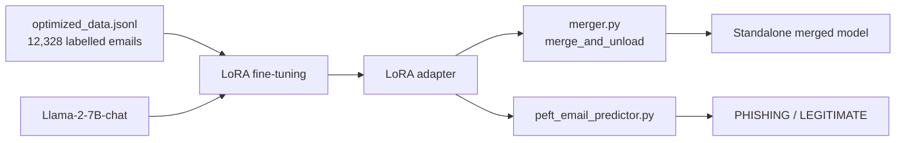

# PEFT-Merging

Phishing email detection with a LoRA-fine-tuned **Llama-2-7B-chat**: merge the adapter into the base model, then classify emails from the CLI.



## Files

| File | What |
|---|---|
| `optimized_data.jsonl` | Training data: `Email Text`, `Email Type` (12,328 rows) |
| `merger.py` | Loads `NousResearch/Llama-2-7b-chat-hf`, applies the LoRA adapter, merges with `merge_and_unload()` and saves a standalone model |
| `peft_email_predictor.py` | CLI classifier: prompts the model and maps its answer to `PHISHING` / `LEGITIMATE` |
| `use_finetuned_model.sh` | Installs missing packages and runs the predictor |

## Usage

The adapter weights are not committed (size). Put your adapter in `./phishing_finetuned_model`, then:

```bash
pip install transformers peft torch safetensors
python peft_email_predictor.py --email "Your account is locked, verify here: http://..."
python peft_email_predictor.py --file email.txt --verbose
python merger.py   # writes ./phishing_finetuned_complete
```

## Notes

- The reported confidence is a heuristic (90% when the model's answer is unambiguous, 60% otherwise), not a calibrated probability.
- Unclear model answers default to `PHISHING` to fail safe.
